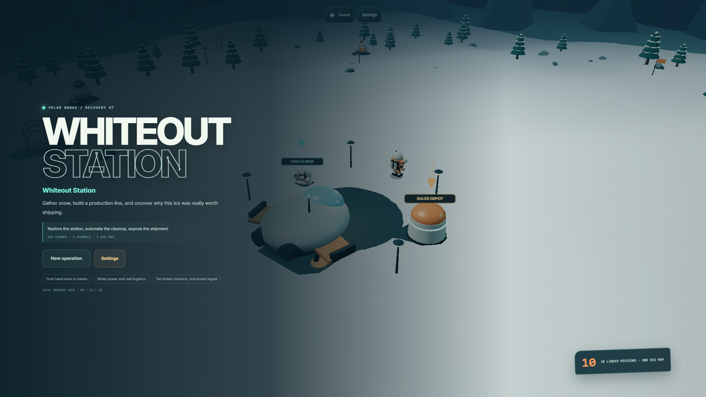
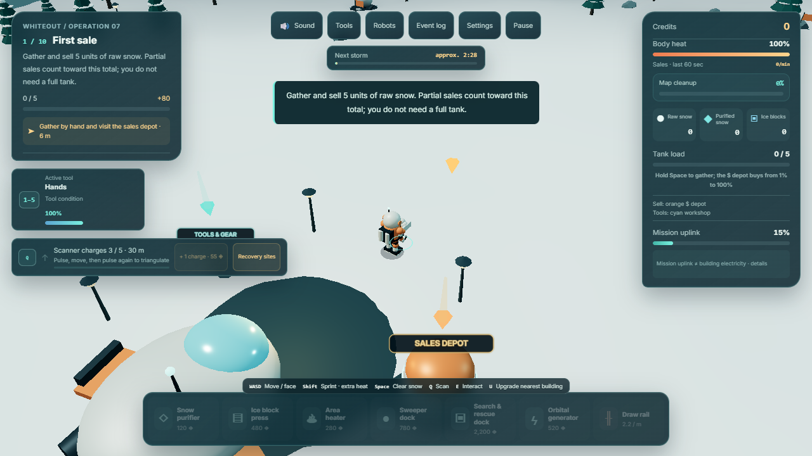
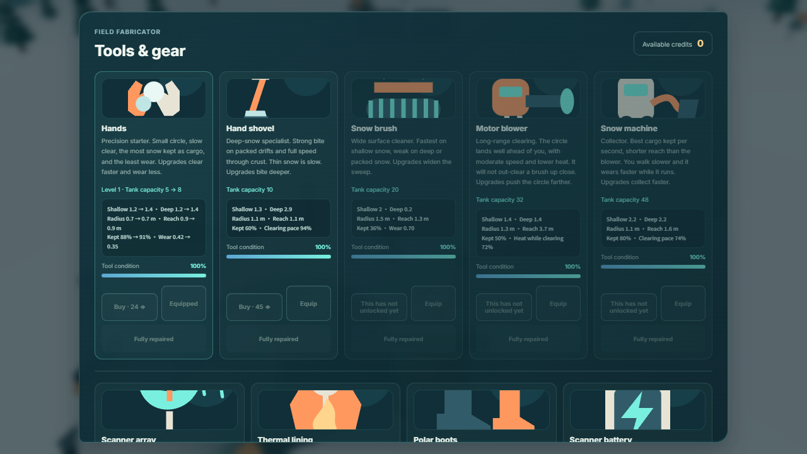
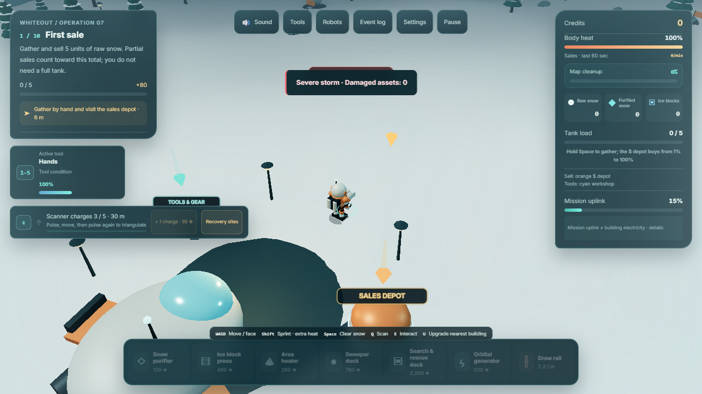
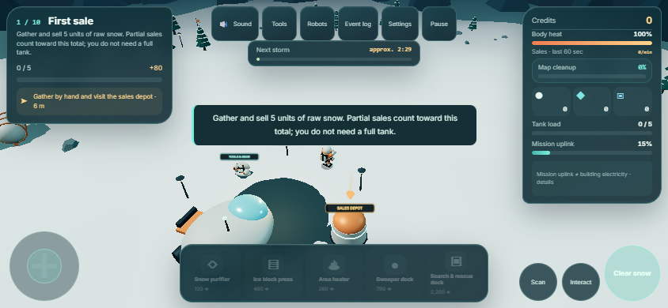
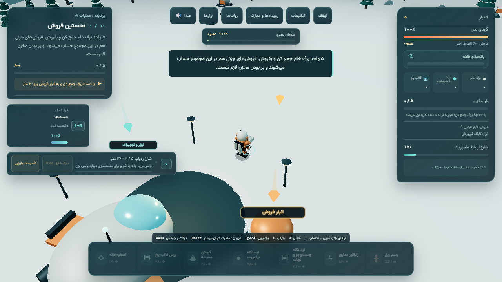
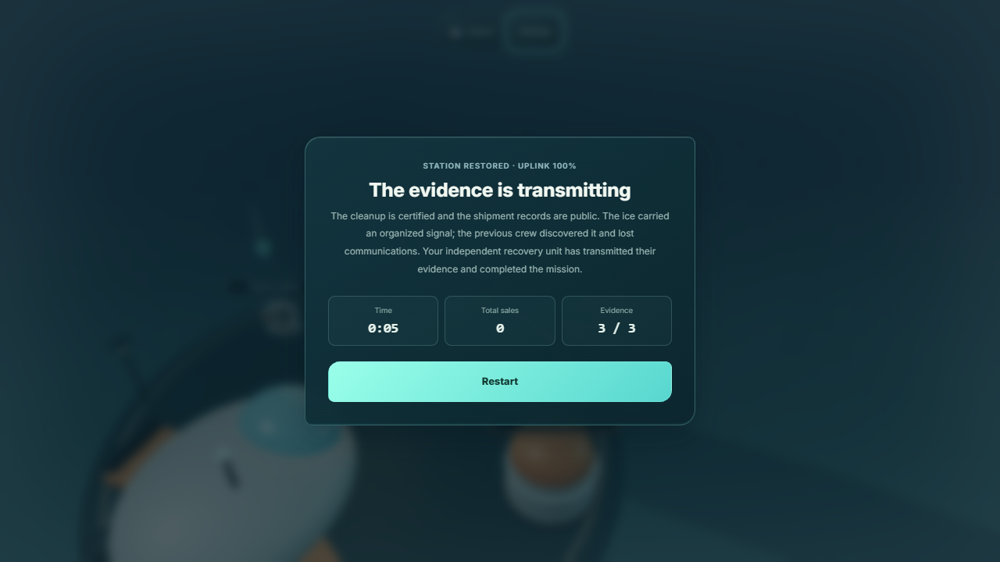

# Whiteout Station

On a world buried beneath an endless winter, every cleared meter matters.

A recovery station, a buried signal, and a shipment that should not exist.



## Cinematic intro

You come down as an independent recovery unit. The landing zone is already under deep snow, and the ship that brought you is now part of the station. The brief is simple at first: clear a path, sell what you gather, and bring the yard back to life. The ice pays well. It also carries a structured signal. The previous crew found that signal, and their communications were cut. Your job is to clear the map, recover their records, restore the mission uplink, and transmit the evidence instead of hiding it.

## What it is

Whiteout Station is a browser-based independent project. This repository is a release candidate ready for external playtesting. You play alone, in one browser tab, on one machine. There are no accounts, no multiplayer, no native mobile app, and no store build. It has not been validated on a physical phone or tablet, and it is not publicly deployed.

Progress stays in this browser’s local save. Clearing site data removes that save.

## Core loop

Gather raw snow by hand. Sell it at the orange sales depot, or feed it into a snow purifier. Purified snow can be sold or pressed into ice blocks. Ice sells for 42 credits a block. Credits pay for tools, buildings, upgrades, and repairs. The station is finished only when three separate conditions are all true: 95% of the map is cleared, all three evidence caches are recovered, and the mission uplink is at 100%. Selling ice pays credits. It does not fill the uplink.

## Features

- Ten linked missions on one large snow map
- Five hand tools, each with its own job and upgrade track
- A production line: sweeper dock, snow purifier, ice block press, and sales depot
- Area heaters, an orbital generator, and a wired power network separate from the mission uplink
- Sweeper robots with dock-level work areas, plus one search-and-rescue robot
- Freehand maglev rails that merge, split, and cross, and carry one-way cargo capsules
- Storms, including severe storms, that drain heat, slow you, and can freeze robots or damage buildings
- English, Persian, and Simplified Chinese, with locally hosted fonts
- Desktop keyboard and mouse play, and a landscape touch layout

## Automation and logistics

Early on you carry snow yourself. Later, a sweeper dock sends robots out to clear assigned ground and unload raw snow. A purifier turns raw snow into purified snow. A press turns purified snow into ice. Rails move those goods one way, in capsules, between a dock, a machine, and the sales depot. You can still load and unload by hand with E. A full tank is not required for a sale.

## Snow clearing, tools, and upgrades

Hold Space, or hold the left mouse button, to clear snow in front of you. The equipped tool decides the shape of that work.

| Key | Tool | Role |
| --- | --- | --- |
| 1 | Hands | Precise starter. Small circle, slow clear, most snow kept as cargo, least wear |
| 2 | Hand shovel | Deep and packed snow |
| 3 | Snow brush | Fast on shallow snow, weak on deep snow |
| 4 | Motor blower | Long reach, moderate speed |
| 5 | Snow machine | Best cargo kept per second, shorter reach than the blower, more wear |

Tools unlock as missions advance. Each tool upgrades its own job and its own tank. The workshop also sells a scanner array, thermal lining, and polar boots. Tool condition falls while a tool is actually clearing snow. A broken tool keeps its cargo; repair it at the workshop.

## Robots and work areas

A sweeper dock supports more robots as it is upgraded. Robots start on an automatic area around the dock. You can assign a work circle, or send them back to automatic. If that circle has no reachable snow, they fall back to nearby snow and keep the order you set. They still retreat from storms.

The search-and-rescue dock flies an aerial unit. It can thaw a frozen robot and, if you allow it, repair storm-damaged buildings at the normal repair cost. It can freeze too. A manual thaw at a frozen robot costs 150 credits.

## Rail construction and cargo

Press R, or choose Draw rail, to enter drawing. Drag a path and release on a compatible port or track. Raw snow only travels to a purifier. Purified snow travels to a press or the sales depot. Ice travels to the depot. The line can merge, split, or cross. A junction can stay automatic or use priority or a ratio. You can edit or delete a segment. Deleting a rail does not refund its cost. A segment that still has a capsule on it cannot be edited until it is empty. Right-click or Esc cancels a placement. While you are drawing, right-drag the mouse to rotate the view, and use the wheel to zoom.

## Storms, heat, and survival

Body heat falls while you work and falls faster in a storm. Sprint costs extra heat. Return to the base or a powered heater before heat runs out. A storm warning appears before the storm. Severe storms last longer, can damage buildings, and can freeze robots that are outside warmth. Powered heaters melt snow and block regrowth in their area. Generators power nearby buildings. They do not charge the mission uplink.

## Missions and progression

The left card is the current mission. The right card is credits, body heat, cargo, and the uplink. The ten missions move you from a first sale, through a purifier and an ice press, into rails, robots, and heated ground. The last mission is the real shipment: clear 95% of the map, bring back all three evidence caches, and restore the mission uplink to 100%. A later storm does not revoke a cleanup certificate you have already earned. Missions and the three caches stop the uplink at 92%. At least two restored recovery sites are required to reach 100%.

## Desktop controls

These are the bindings in the game code.

| Input | Action |
| --- | --- |
| W A S D or arrow keys | Move and face |
| Shift | Sprint. Costs extra heat |
| Space, or hold the left mouse button | Clear snow |
| Q | Scanner pulse |
| E | Interact: sell, deposit, collect, repair, thaw |
| U | Upgrade the nearest building |
| T | Open the tool workshop |
| R | Draw a maglev rail |
| 1 2 3 4 5 | Equip hands, shovel, brush, blower, or snow machine |
| M | Mute or unmute |
| P or Esc | Pause or resume. Esc also cancels building, rail drawing, and work-area placement |
| Ctrl, hold | Show the fuller HUD details |
| [ and ] | Rotate the camera |
| Mouse wheel | Zoom the camera |
| Right-drag while drawing a rail | Rotate the view |
| Enter | Confirm a rail edit or a work area |
| Right-click | Cancel building placement or a work-area pick |

On the title, victory, or game-over screen, Space or Enter starts a new operation. During the arrival scene, Esc, P, Space, or Enter skips it.

## Touch controls and known limits

Landscape is the playable layout. A stick on the left moves and faces the unit. Push the stick almost all the way to sprint. On the right: Scan, Interact, and Clear snow. The same on-screen buttons open tools, robots, the log, settings, pause, and construction.

Portrait does not offer the full control set. A short recommendation asks you to rotate to landscape. It does not cover the station, and it does not pause the operation, but the movement stick stays hidden until the screen is wide. This was checked in a desktop browser emulation. It has not been tested on a physical phone or tablet.

A second finger rotates the camera while a rail is being drawn. It does not rotate the camera during ordinary walking.

## Tech stack

- TypeScript, React, and Vite
- Three.js for the world, with Rapier for the ground and the player body
- camera-controls for camera smoothing
- PathFinding.js for robot paths
- Playwright for the browser verification scripts
- Local WOFF2 fonts: Inter, Vazirmatn, and a Noto Sans SC subset

## Local install and launch

Requires Node.js.

```bash
npm install
npm run dev
```

Vite serves the game at [http://127.0.0.1:3000/](http://127.0.0.1:3000/). Choose **New operation**. The browser keeps the career locally.

A production build:

```bash
npm run build
npm run preview
```

## Build and verification commands

From `package.json`:

```bash
npm run check
npm run build
npm run verify
npm run stability
npm run thermal
```

`npm run check` is the TypeScript project build. `npm run build` typechecks and writes `dist`. `npm run verify` runs `scripts/verify-game.mjs`. The `scripts` folder also contains further Playwright and simulation checks used while developing this candidate. They drive an isolated page. They are not a substitute for playing the game yourself.

## Current status

Release candidate for external playtesting. English, Persian, and Simplified Chinese are in the build. Ice sells for 42 credits. The save schema is 11. Desktop play and browser-emulated touch were exercised for this candidate. Physical-device play, public hosting, and store distribution were not.

## Languages

The settings screen offers English, Persian, and Simplified Chinese. Persian uses right-to-left text. The mission card stays on the left and the resource card stays on the right in every language. Fonts are bundled. The game does not request a font CDN during play.

## Screenshots













The victory image is from an isolated browser session used to open that screen. It is not a saved public career.

## Credits, attribution, and font licenses

The station, machines, robots, rails, snow, and character are built in code for this project. Audio files under `public/assets/audio` were generated for this project. Shop art is local SVG.

Libraries:

- Three.js — MIT
- React — MIT
- Vite — MIT
- Playwright — Apache-2.0
- Rapier (`@dimforge/rapier3d-compat`) — Apache-2.0
- camera-controls — MIT
- PathFinding.js (`pathfinding`) — MIT

Fonts, all SIL Open Font License 1.1, stored in `public/fonts` with their license files:

- Inter 4.1, from [rsms/inter](https://github.com/rsms/inter). File: `public/fonts/InterVariable.woff2`. License: `public/fonts/Inter-LICENSE.txt`.
- Vazirmatn 33.003, from [rastikerdar/vazirmatn](https://github.com/rastikerdar/vazirmatn). File: `public/fonts/Vazirmatn.woff2`. License: `public/fonts/Vazirmatn-OFL.txt`.
- Noto Sans SC, a subset of the variable font from [google/fonts `ofl/notosanssc`](https://github.com/google/fonts/tree/main/ofl/notosanssc). File: `public/fonts/NotoSansSC.woff2`. License: `public/fonts/NotoSansSC-OFL.txt`.

See `public/fonts/NOTICES.md` and `CREDITS.md` for the fuller attribution note.
